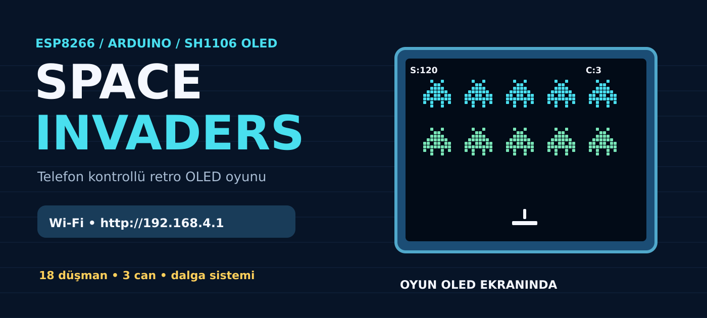
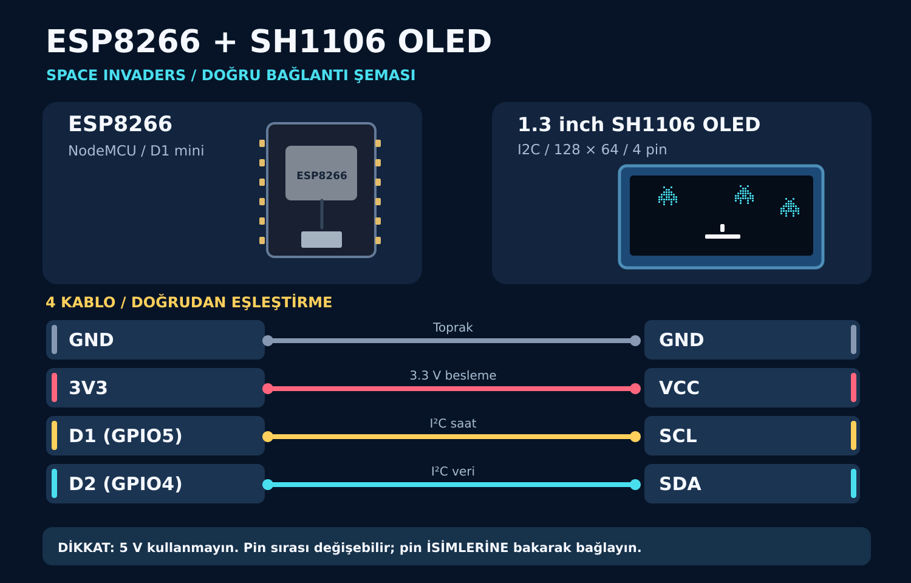
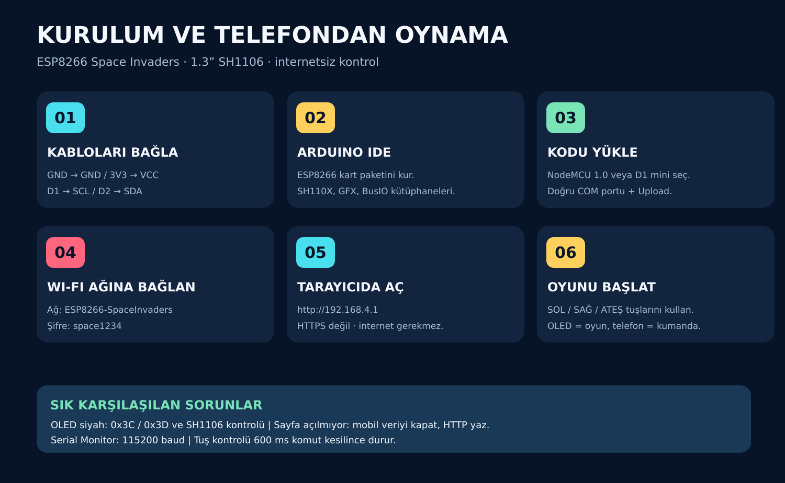

# Space Invaders — ESP8266 + SH1106 OLED + Telefon Kontrolü



**İnternet veya mobil uygulama gerektirmeyen, telefondan kontrol edilen OLED Space Invaders oyunu.** Oyun 1.3 inç OLED ekranda çalışır; telefonun tarayıcısı yalnızca gamepad görevi görür.

> Bu repo, paylaşılan Arduino kaynak kodu ve kurulum notları temel alınarak paketlendi. Arduino sketch'in oyun mantığı değiştirilmedi. Yeni paket gerçek donanım üzerinde tekrar derlenip test edilmedi.

## 1. Bağlantı şeması



| 1.3″ SH1106 OLED pini | ESP8266 NodeMCU / Wemos D1 mini | Açıklama |
|---|---|---|
| `GND` | `GND` | Toprak |
| `VCC` | `3V3` | **5V değil, 3.3V** |
| `SCL` | `D1` (`GPIO5`) | I²C saat hattı |
| `SDA` | `D2` (`GPIO4`) | I²C veri hattı |

**Önemli:** OLED modüllerinde fiziksel pin sırası değişebilir. Kartların üzerindeki pin *isimlerini* esas alın. Kodun varsayılan OLED I²C adresi `0x3C`'dir; ekran yanıt vermiyorsa `0x3D`'yi tarayıcıyla kontrol edin. Proje, **SH1106** sürücü için yazılmıştır; SSD1306 ekranda ek kod değişikliği gerekebilir.

## 2. Gerekli malzemeler

| Parça | Adet |
|---|---:|
| ESP8266 NodeMCU veya Wemos D1 mini | 1 |
| 1.3″ 128×64, I²C, 4 pinli SH1106 OLED ekran | 1 |
| Jumper kablo (kart üzerindeki pinlere uygun tipte) | 4 |
| ESP8266 kartının soketine uygun USB veri/güç kablosu | 1 |
| Wi-Fi ve tarayıcı bulunan telefon | 1 |

Ek buton, joystick, dokunmatik sensör, router, internet veya ücretli API **gerekmez**.

## 3. Arduino IDE kurulumu

1. Arduino IDE'yi kurun.
2. **File / Preferences / Additional Boards Manager URLs** alanına ekleyin:
   ```text
   https://arduino.esp8266.com/stable/package_esp8266com_index.json
   ```
3. **Boards Manager** bölümünden **esp8266 by ESP8266 Community** paketini yükleyin.
4. **Library Manager** bölümünden şu kütüphaneleri yükleyin:
   - `Adafruit SH110X`
   - `Adafruit GFX Library`
   - `Adafruit BusIO` (genellikle bağımlılık olarak gelir)
5. **File → Open** ile `SpaceInvaders_ESP8266_TelefonKontrol/SpaceInvaders_ESP8266_TelefonKontrol.ino` dosyasını açın.
6. **Tools → Board** bölümünden kartınıza göre **NodeMCU 1.0 (ESP-12E Module)** veya kullandığınız D1 mini kartını seçin. Doğru **Port/COM**'u seçin.
7. USB kablosuyla karta bağlanın ve **Upload / Yükle** düğmesine basın.

`Wire`, `ESP8266WiFi`, `ESP8266WebServer` kütüphaneleri ESP8266 kart paketinde bulunur.

## 4. Telefondan bağlanıp oynama



1. ESP8266'yı USB ile besleyin.
2. Telefonda Wi-Fi ağına bağlanın:
   - **Ağ adı (SSID):** `ESP8266-SpaceInvaders`
   - **Şifre:** `space1234`
3. Telefon **“Bu ağda internet yok”** uyarısını gösterirse bağlantıyı koruyun. Gerekirse mobil veriyi geçici olarak kapatın.
4. Tarayıcıya **`http://192.168.4.1`** yazın (`https` değil).
5. **OYUNU BAŞLAT / YENİDEN BAŞLAT** düğmesine dokunun.
6. **SOL, SAĞ, ATEŞ** düğmelerine basılı tutarak oynayın. Çoklu dokunmatik destekleyen telefonlarda hareket ve ateş beraber kullanılabilir.

> Telefonda oyunun görüntüsü akmaz. Asıl oyun görüntüsü OLED ekran üzerindedir. Telefon oyun kumandasıdır.

## 5. Oyun özellikleri

- 3 satır × 6 sütunda toplam **18 düşman**
- Başlangıçta **3 can**, oyuncu ve düşman atışları
- Skor, dalga sistemi ve giderek hızlanan düşmanlar
- Game over ve yeniden başlatma ekranları
- Rekor skoru RAM'de tutar: **ESP8266 kapatılınca sıfırlanır**
- Telefon tuş komutları **600 ms** kesilirse kontrol otomatik bırakılır
- Yerel erişim noktası: modem/router bağlantısı gerekmez

## 6. Sorun giderme

| Sorun | Kontrol edin |
|---|---|
| OLED siyah / açılmıyor | GND/VCC, D1=SCL, D2=SDA, ekranın SH1106 olması, 0x3C/0x3D I²C adresi |
| Wi-Fi ağı çıkmıyor | USB beslemesi, doğru kart seçimi, **Serial Monitor: 115200 baud** |
| `192.168.4.1` açılmıyor | Doğru SSID, **http** kullanımı, mobil veriyi geçici kapatma |
| Yükleme hatası | Doğru USB veri kablosu, COM portu, kart sürücüsü |
| Ekran adresinden emin değilseniz | `tools/I2C_Adres_Tarayici/` altındaki yardımcı sketch'i çalıştırın; oyun sketch'ini sonra yeniden yükleyin |
| Tuş basılı kaldı gibi görünüyorsa | Tarayıcıda sayfayı yeniden açın; oyun kodu 600 ms sonra kontrolleri bırakır |

## 7. Dosya yapısı

```text
esp8266-oled-space-invaders/
├── SpaceInvaders_ESP8266_TelefonKontrol/
│   └── SpaceInvaders_ESP8266_TelefonKontrol.ino  # Ana oyun kodu
├── docs/
│   ├── kapak.png / .svg
│   ├── baglanti-semasi.png / .svg
│   ├── kurulum-kilavuzu.png / .svg
│   └── ORIJINAL_KURULUM_NOTLARI.txt
├── tools/
│   └── I2C_Adres_Tarayici/
│       └── I2C_Adres_Tarayici.ino
├── .gitignore
├── LICENSE
└── README.md
```

## 8. Kendi ayarlarını değiştirme

Ana `.ino` dosyasının başındaki sabitlerden `AP_SSID`, `AP_PASSWORD`, `OLED_I2C_ADDRESS`, `OLED_SDA_PIN`, `OLED_SCL_PIN` düzenlenebilir. Wi-Fi şifresi en az 8 karakter olmalıdır.

**Güvenlik notu:** Varsayılan Wi-Fi şifresi kaynak kodda açıktır. Bu nedenle kendi cihazınızda ağı paylaşmadan önce farklı bir şifre kullanmanız önerilir. Bu, internete açılan bir servis değil, kısa menzilli yerel ESP8266 erişim noktasıdır.

## Kaynaklar

- [Arduino ESP8266 kart paketi](https://github.com/esp8266/Arduino)
- [Adafruit SH110X](https://github.com/adafruit/Adafruit_SH110x)
- [Adafruit GFX Library](https://github.com/adafruit/Adafruit-GFX-Library)

## Lisans ve doğrulama

MIT lisansı (`LICENSE`), projeyi isteyenlerin kaynak kodu açıkça kullanabilmesini sağlar. **Paket içeriği dosya tutarlılığı için kontrol edildi; fiziksel ESP8266/SH1106 cihazında çalışma doğrulanmadı.**
